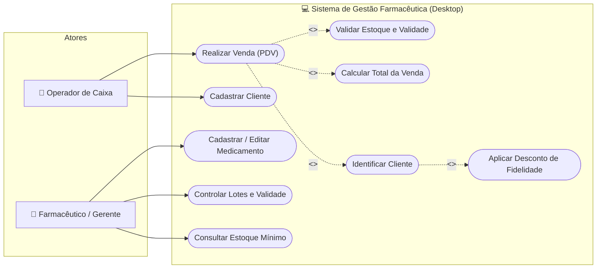
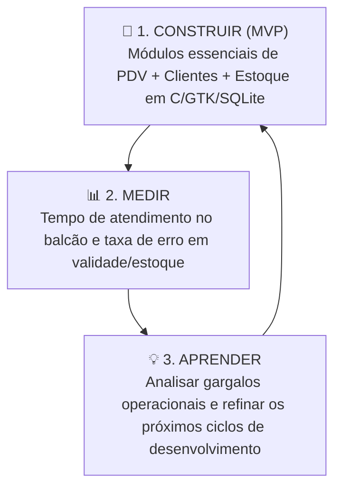

# Histórias de Usuários, Casos de Uso e MVP (Baseado no Cap. 3 do Valente)

Este documento estabelece a especificação de requisitos ágeis e estruturados para o **Sistema Desktop de Farmácia (Inspirado na Rede Pague Menos)**, elaborado em estrita conformidade com os conceitos, técnicas e padrões apresentados no **Capítulo 3 (Requisitos) do livro *Engenharia de Software Moderna*, de Marco Tulio Valente**.

---

## 1. Fundamentação Teórica (Valente, Cap. 3)

Segundo Valente:
1. **Histórias de Usuários (Seção 3.3):** Adotadas em métodos ágeis para substituir longos documentos de requisitos por comunicação frequente. São estruturadas na equação:
   $$\text{História de Usuário} = \text{Cartão} + \text{Conversas} + \text{Confirmação}$$
   Seguem o acrônimo **INVEST** (*Independent, Negotiable, Valuable, Estimable, Small, Testable*).
2. **Casos de Uso (Seção 3.4):** Descrevem sequências de interações entre um **ator** (entidade externa com um objetivo) e o sistema. Possuem um **fluxo normal** (fluxo feliz com passos numerados) e **extensões** (alternativas e tratamento de erros). No diagrama UML, contemplam relacionamentos de associação, `<<include>>` e `<<extend>>`.
3. **Produto Mínimo Viável - MVP (Seção 3.5):** Inspirado no *Lean Startup* (Eric Ries), é a versão mais simples do produto necessária para validar hipóteses de negócio com o menor esforço e tempo de desenvolvimento, baseado no ciclo **Construir $\rightarrow$ Medir $\rightarrow$ Aprender**.

---

## 2. Personas / Papéis de Usuários

Antes de escrever as histórias, mapeamos os usuários que interagem com o sistema de farmácia (conforme preconizado por Valente para evitar vieses):

| Papel / Persona | Descrição | Foco Principal |
| :--- | :--- | :--- |
| **Operador de Caixa / Atendente** | Responsável pelo atendimento direto ao balcão e PDV. | Agilidade no registro de compras, busca rápida de medicamentos e fechamento do cupom. |
| **Farmacêutico / Gerente de Estoque** | Responsável técnico pela dispensação, validade e estoque. | Controle de lotes, reposição de estoque crítico e bloqueio de medicamentos vencidos. |
| **Cliente da Farmácia** | Consumidor que adquire remédios e itens de higiene. | Consulta rápida de preços e identificação para programas de fidelidade/descontos. |

---

## 3. Histórias de Usuários (Seção 3.3 do Valente)

Cada história é descrita com seu **Cartão** (formato clássico: *Como [papel], quero [funcionalidade] para que [benefício]*), resumo das **Conversas** e os critérios de **Confirmação** (testes de aceitação objetivos).

### US01 - Busca Rápida de Medicamentos no Balcão
* **Cartão:**
  > **Como** atendente de balcão,  
  > **quero** pesquisar medicamentos por nome ou código de barras instantaneamente,  
  > **para que** eu informe o preço e disponibilidade ao cliente sem gerar filas.
* **Conversas:** O atendente precisa digitar apenas as letras iniciais do nome comercial ou bipar o código de barras. A busca deve exibir imediatamente o preço e o saldo em estoque.
* **Confirmação (Critérios de Aceitação):**
  - [x] Ao digitar "Dip" no campo de busca, o sistema deve listar "Dipirona 500mg" e similares em menos de 1 segundo.
  - [x] Ao bipar um código de barras existente, o produto correspondente deve ser selecionado de imediato.
  - [x] Se o produto não existir, o sistema deve exibir uma mensagem clara indicando "Nenhum produto localizado".

---

### US02 - Registro de Venda no Ponto de Venda (PDV)
* **Cartão:**
  > **Como** operador de caixa,  
  > **quero** registrar os itens comprados pelo cliente com cálculo automático de subtotais e total,  
  > **para que** a cobrança seja exata, confiável e rápida.
* **Conversas:** Cada item adicionado deve exibir quantidade, preço unitário e subtotal. O operador pode excluir um item da lista antes de finalizar a venda.
* **Confirmação (Critérios de Aceitação):**
  - [x] O valor total da venda deve ser recalculado dinamicamente a cada inclusão ou remoção de item.
  - [x] Ao finalizar a venda com sucesso, o sistema deve registrar a transação no banco de dados e dar baixa automática na quantidade em estoque de cada item vendido.
  - [x] Não deve ser possível finalizar uma venda sem nenhum item na cesta.

---

### US03 - Bloqueio de Medicamento Vencido
* **Cartão:**
  > **Como** farmacêutico responsável,  
  > **quero** que o sistema impeça a inserção de produtos vencidos em uma venda,  
  > **para que** a farmácia cumpra as normas sanitárias da ANVISA e proteja a saúde dos clientes.
* **Conversas:** Se a data de validade do lote for menor ou igual à data atual do sistema, a venda deve ser barrada imediatamente com um alerta explicativo.
* **Confirmação (Critérios de Aceitação):**
  - [x] Ao tentar adicionar um medicamento com data de validade vencida, o sistema deve emitir um alerta de bloqueio e não permitir a inclusão do item.
  - [x] Na listagem de produtos, itens vencidos ou a vencer em menos de 30 dias devem receber destaque visual de atenção.

---

### US04 - Alerta de Estoque Mínimo
* **Cartão:**
  > **Como** gerente de estoque,  
  > **quero** visualizar quais medicamentos atingiram o limite mínimo de unidades,  
  > **para que** eu providencie o pedido de reposição com os fornecedores antes que o item falte.
* **Conversas:** A tela de produtos deve ter um filtro ou indicador claro para todos os itens onde `quantidade_estoque <= estoque_minimo`.
* **Confirmação (Critérios de Aceitação):**
  - [x] O sistema deve sinalizar remédios com quantidade abaixo do estoque mínimo.
  - [x] Ao realizar a entrada de reposição de estoque, o saldo deve ser atualizado e o alerta deve ser desativado caso o saldo supere o mínimo.

---

### US05 - Identificação de Cliente para Fidelidade (Pague Menos)
* **Cartão:**
  > **Como** operador de caixa,  
  > **quero** identificar o cliente pelo CPF no início ou durante a venda,  
  > **para que** a compra seja vinculada ao histórico do cliente e conceda descontos de fidelidade.
* **Conversas:** O cliente informa o CPF. O sistema valida os dígitos e preenche o nome do cliente na tela da venda. Se o cliente não tiver cadastro prévio, deve ser possível abri-lo rapidamente.
* **Confirmação (Critérios de Aceitação):**
  - [x] O sistema deve validar o algoritmo do CPF rejeitando CPFs inválidos.
  - [x] Caso o CPF seja localizado, o nome do cliente deve aparecer vinculado à venda atual.
  - [x] O operador pode finalizar a venda como "Consumidor Final Não Identificado" caso o cliente recuse informar o documento.

---

## 4. Casos de Uso (Seção 3.4 do Valente)

Conforme a metodologia de Valente, os casos de uso são nomeados com verbos no infinitivo e detalham o **fluxo normal** (cenário feliz) e suas **extensões** (desvios e erros).

### Caso de Uso 01: Realizar Venda de Medicamentos (PDV)
* **Ator Principal:** Operador de Caixa
* **Atores Secundários:** Cliente da Farmácia
* **Pré-condições:** O operador de caixa está com a tela do PDV aberta; existem produtos cadastrados no sistema.
* **Pós-condições:** Venda gravada no banco de dados; estoque dos produtos decrementado; histórico de venda gerado.

#### Fluxo Normal:
1. Operador inicia uma nova venda.
2. Operador inclui o Caso de Uso *Identificar Cliente* (opcional).
3. Operador pesquisa o medicamento por código de barras ou nome.
4. Sistema exibe o produto com preço unitário e estoque atual.
5. Operador informa a quantidade desejada e confirma a inclusão.
6. Sistema inclui o Caso de Uso *Validar Estoque e Validade*.
7. Sistema adiciona o item na tabela da venda e atualiza o valor total acumulado.
8. Operador repete os passos 3 a 7 para todos os itens do cliente.
9. Operador aciona o comando "Finalizar Venda".
10. Sistema inclui o Caso de Uso *Calcular Total com Desconto*.
11. Sistema persiste a venda e seus itens no banco de dados.
12. Sistema atualiza o estoque de cada produto vendido.
13. Sistema emite mensagem de confirmação de venda concluída e limpa a tela para o próximo cliente.

#### Extensões:
* **2a - Cliente não deseja se identificar:**
  * 2a.1 - O sistema vincula a transação como "Consumidor Final" e prossegue no passo 3.
* **3a - Medicamento não encontrado:**
  * 3a.1 - Sistema exibe aviso: *"Produto não cadastrado"*.
  * 3a.2 - Operador pode tentar novo código/nome ou cancelar a inclusão do item.
* **6a - Quantidade solicitada maior que o estoque disponível:**
  * 6a.1 - Sistema exibe alerta: *"Estoque insuficiente (Saldo atual: X)"*.
  * 6a.2 - O item não é adicionado e o fluxo retorna ao passo 5.
* **6b - Medicamento com data de validade vencida:**
  * 6b.1 - Sistema bloqueia a inclusão e exibe alerta: *"Medicamento vencido em [data]. Venda proibida por normas sanitárias"*.
  * 6b.2 - O fluxo retorna ao passo 3.
* **9a - Operador decide remover um item antes da finalização:**
  * 9a.1 - Operador seleciona a linha do item e aciona "Remover Item".
  * 9a.2 - Sistema remove o item, recalcula o total da venda e retorna ao passo 8.
* **11a - Falha de comunicação com o banco de dados:**
  * 11a.1 - Sistema emite erro: *"Falha ao gravar venda. Nenhuma alteração foi efetuada no estoque"*.
  * 11a.2 - A transação é abortada sem inconsistência de dados.

---

### Caso de Uso 02: Cadastrar Medicamento
* **Ator Principal:** Farmacêutico / Gerente
* **Fluxo Normal:**
  1. Ator solicita o cadastro de um novo produto.
  2. Sistema abre o formulário de cadastro.
  3. Ator preenche código de barras, nome comercial, princípio ativo, preço de custo, preço de venda, quantidade inicial, estoque mínimo, validade e fornecedor.
  4. Ator confirma o salvamento.
  5. Sistema valida se os campos obrigatórios estão preenchidos e se preços são maiores que zero.
  6. Sistema grava o medicamento no banco de dados.
  7. Sistema exibe mensagem de sucesso e atualiza a listagem de produtos.
* **Extensões:**
  * **5a - Código de barras já cadastrado no sistema:**
    * 5a.1 - Sistema avisa: *"Código de barras já vinculado a outro medicamento"*.
    * 5a.2 - Sistema mantém os dados no formulário e solicita correção do código.
  * **5b - Preço de venda menor que preço de custo:**
    * 5b.1 - Sistema exibe alerta de margem negativa e solicita confirmação explícita do gerente.

---

### Caso de Uso 03: Controlar Lotes e Validade
* **Ator Principal:** Farmacêutico
* **Fluxo Normal:**
  1. Farmacêutico acessa o painel de controle de estoque.
  2. Sistema carrega todos os medicamentos e calcula a diferença entre a data atual e a data de validade.
  3. Sistema aplica filtros automáticos destacando:
     - Lotes Vencidos (crítico - venda bloqueada).
     - Lotes a Vencer em até 30 dias (alerta de reposição/promoção).
  4. Farmacêutico seleciona um lote crítico e executa ação de baixa por vencimento ou reposição.

---

## 5. Diagrama de Casos de Uso (UML)

O diagrama abaixo representa a fronteira do sistema, os atores externos e os relacionamentos de associação, `<<include>>` (inclusão obrigatória) e `<<extend>>` (extensão condicional):

---

## 6. Produto Mínimo Viável (MVP) — Seção 3.5 do Valente

### 6.1. Definição do MVP
Na definição de Valente e Eric Ries (*Lean Startup*), o **MVP (Produto Mínimo Viável)** é a versão mais enxuta do software que permite validar a hipótese central de valor do produto no mundo real, consumindo o menor tempo e custo de desenvolvimento possível.

### 6.2. Ciclo Construir $\rightarrow$ Medir $\rightarrow$ Aprender

1. **Construir:** Implementar apenas as funcionalidades indispensáveis para a farmácia operar um dia completo de balcão sem travamentos.
2. **Medir:** Avaliar métricas quantitativas com operadores reais de caixa e atendentes.
3. **Aprender:** Descobrir se a operação desktop em C/GTK é ágil e quais recursos secundários realmente agregam valor.

### 6.3. Hipótese de Negócio a ser Validada
> *"Um sistema desktop leve em C com interface GTK é capaz de agilizar o atendimento de balcão em farmácias, garantindo que nenhuma venda seja concluída com estoque furado ou medicamentos vencidos, mantendo um cadastro unificado de clientes fidelizados."*

---

### 6.4. Matriz de Escopo: O que entra no MVP vs Futuro

Para evitar o maior desperdício apontado por Valente (desenvolver funcionalidades complexas que ninguém usará), o escopo é dividido com rigor:

| Funcionalidade | Presente no MVP 1.0? | Justificativa segundo Valente / Lean |
| :--- | :---: | :--- |
| **Cadastro e busca de Clientes** | **SIM** | Essencial para o programa de fidelidade da rede e histórico. |
| **Cadastro e busca de Produtos** | **SIM** | Sem catálogo de remédios com preço e código, o sistema não opera. |
| **Registro de Venda direta (PDV)** | **SIM** | É o motor central de geração de valor da farmácia. |
| **Cálculo de Total e Subtotais** | **SIM** | Obrigatório para a cobrança no caixa. |
| **Baixa Automática no Estoque** | **SIM** | Essencial para evitar venda em duplicidade de produtos escassos. |
| **Bloqueio de Remédio Vencido** | **SIM** | Requisito sanitário mandatório para o negócio. |
| **Persistência em Banco SQLite Local** | **SIM** | Garante que os dados não se percam ao reiniciar a máquina. |
| *Emissão de Nota Fiscal Eletrônica (NFC-e)* | **NÃO (Pós-MVP)** | Depende de certificados digitais e SEFAZ; complexidade dispensável para validar a usabilidade inicial. |
| *Integração com Cartão de Crédito (TEF)* | **NÃO (Pós-MVP)** | Pode ser operado via maquininha POS física separada durante o teste do MVP. |
| *Módulo Completo de Cotação de Fornecedores* | **NÃO (Pós-MVP)** | Entradas manuais de estoque bastam para validar a operação primária. |
| *Sincronização em Nuvem / Multi-filiais* | **NÃO (Pós-MVP)** | O foco inicial é a robustez do terminal local da loja. |

---

### 6.5. Métricas de Sucesso do MVP (Como Medir)

Para comprovar cientificamente o sucesso do MVP:
1. **Tempo Médio de Atendimento (TMA):** O operador deve conseguir registrar uma venda de 3 itens e finalizá-la em menos de **45 segundos**.
2. **Índice de Bloqueio de Inconsistências:** **100%** das tentativas de vender medicamentos vencidos ou sem saldo de estoque devem ser barradas com sucesso.
3. **Estabilidade Técnica:** Zero ocorrências de falhas críticas de segmentação (*Segmentation Fault*) ou travamentos de tela durante a operação contínua do GTK.
