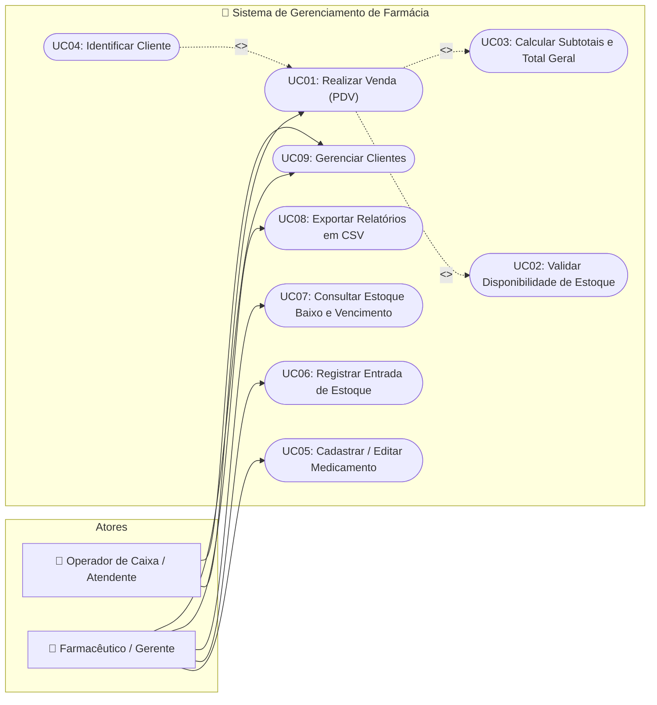
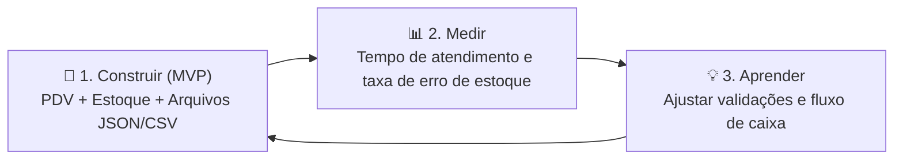

# Histórias de Usuários, Casos de Uso com Diagramas e MVP

**Disciplina:** Engenharia de Software / Programação  
**Referência Teórica:** VALENTE, Marco Tulio. *Engenharia de Software Moderna: Princípios e Práticas para Desenvolvimento de Software com Produtividade*. Belo Horizonte, 2020. **Capítulo 3: Requisitos**. (Disponível em: https://engsoftmoderna.info/cap3.html)

---

## 1. Fundamentação Teórica (Valente, Cap. 3)

Segundo Marco Tulio Valente:
> *"Requisitos são a 'ponte' que liga um problema do mundo real a um sistema de software que o soluciona."* (p. 89)

No desenvolvimento moderno de software, os requisitos devem ser comunicados de duas formas complementares:
1. **Histórias de Usuários (Seção 3.3):** Adotadas em métodos ágeis (Scrum/XP), representam requisitos no formato:
   $$\text{História de Usuário} = \text{Cartão (Card)} + \text{Conversas (Conversation)} + \text{Confirmação (Confirmation)}$$
   Seguem rigorosamente as diretrizes **INVEST** (*Independent, Negotiable, Valuable, Estimable, Small, Testable*).
2. **Casos de Uso (Seção 3.4):** Descrevem sequências de interações entre um **ator** (entidade externa com um objetivo) e o sistema. Possuem um **fluxo normal** (passos numerados de sucesso) e **fluxos alternativos / extensões** (tratamento de erros). No diagrama UML, utilizam os relacionamentos `<<include>>` (inclusão obrigatória) e `<<extend>>` (extensão condicional/opcional).
3. **Produto Mínimo Viável - MVP (Seção 3.5):** Inspirado no *Lean Startup* (Eric Ries), é a versão mais simples do produto necessária para validar as hipóteses de valor do negócio consumindo o menor tempo e esforço, orientado pelo ciclo **Construir $\rightarrow$ Medir $\rightarrow$ Aprender**.

---

## 2. Atores e Papéis de Usuários

Para evitar vieses e garantir que o software atenda a quem realmente opera o negócio, mapeamos os seguintes atores:

| Ator | Tipo | Responsabilidades e Objetivos no Sistema |
| :--- | :---: | :--- |
| **Operador de Caixa / Atendente** | Ator Primário | Operar o Ponto de Venda (PDV), registrar a compra do cliente, consultar preços rapidamente e finalizar a venda com baixa imediata de estoque. |
| **Farmacêutico / Gerente de Loja** | Ator Primário | Cadastrar medicamentos, controlar níveis de estoque mínimo, registrar reposições de lotes, monitorar validades e emitir relatórios analíticos. |
| **Cliente da Farmácia** | Ator Secundário | Consumidor atendido no balcão que pode opcionalmente fornecer nome e telefone para cadastro e histórico. |

---

## 3. Histórias de Usuários (User Stories — Seção 3.3 do Valente)

Abaixo estão as histórias de usuários que nortearam a implementação do núcleo da farmácia:

---

### US01 — Busca Rápida de Medicamentos no Balcão
* **Cartão (Card):**
  > **Como** atendente de balcão da farmácia,  
  > **quero** pesquisar medicamentos por nome parcial ou código de barras,  
  > **para que** eu informe o preço e a disponibilidade ao cliente em poucos segundos sem formar filas.
* **Conversas (Conversation):** O atendente não pode ser obrigado a digitar o nome completo e exato com acentos e maiúsculas. Uma busca por "dipi" deve encontrar "Dipirona 500mg". O sistema deve exibir imediatamente preço unitário e quantidade física em estoque.
* **Confirmação (Confirmation — Critérios de Aceitação):**
  - [x] O sistema deve realizar a busca sem diferenciar letras maiúsculas de minúsculas (case-insensitive).
  - [x] Ao buscar por código único, o sistema deve retornar o medicamento exato em menos de 1 segundo.
  - [x] Se o medicamento não for localizado, deve exibir uma mensagem clara: `"Medicamento não encontrado"`.

---

### US02 — Registro de Venda no Ponto de Venda (PDV)
* **Cartão (Card):**
  > **Como** operador de caixa,  
  > **quero** adicionar um ou mais medicamentos ao carrinho de compras e registrar a venda com cálculo automático de subtotais e total geral,  
  > **para que** o atendimento seja rápido, exato e livre de erros manuais de cálculo.
* **Conversas (Conversation):** O operador adiciona os itens sequencialmente. O sistema calcula `quantidade * preco_unitario` para cada item e soma o total da venda. O cliente deve ser opcional (a venda pode ser feita sem cadastro do cliente).
* **Confirmação (Confirmation — Critérios de Aceitação):**
  - [x] Cada item adicionado recalcula automaticamente o total geral.
  - [x] O sistema processa sequencialmente o carrinho garantindo que nenhum item possua quantidade zerada ou negativa.
  - [x] A venda pode ser finalizada para cliente cadastrado ou venda anônima de balcão.

---

### US03 — Bloqueio de Venda sem Estoque e Consistência (Tudo ou Nada)
* **Cartão (Card):**
  > **Como** gerente de farmácia,  
  > **quero** que o sistema impeça a finalização de qualquer venda que solicite quantidade superior ao estoque físico disponível,  
  > **para que** a farmácia não venda produtos que não possa entregar ao cliente.
* **Conversas (Conversation):** Se o cliente pedir 10 caixas e só houver 8 no estoque, a venda inteira deve ser bloqueada. Nenhuma baixa parcial pode ocorrer se um dos itens da cesta falhar.
* **Confirmação (Confirmation — Critérios de Aceitação):**
  - [x] Se `quantidade_solicitada > estoque_atual`, o sistema interrompe a operação com a exceção `EstoqueInsuficienteError`.
  - [x] Nenhuma alteração é persistida nos arquivos de dados quando ocorre a falha (consistência atômica).
  - [x] Quando a venda é concluída com sucesso, o estoque do produto é decrementado imediatamente e uma movimentação do tipo `"SAIDA"` é registrada no histórico.

---

### US04 — Controle de Reposição de Estoque (Entradas)
* **Cartão (Card):**
  > **Como** farmacêutico responsável pelo estoque,  
  > **quero** registrar a entrada de novos lotes de medicamentos informando quantidade e justificativa,  
  > **para que** o saldo físico seja atualizado e haja rastreabilidade sobre a procedência da mercadoria.
* **Conversas (Conversation):** O farmacêutico recebe caixas da distribuidora, digita o ID do medicamento e a quantidade recebida. O sistema soma a quantidade ao estoque anterior e grava um registro de entrada com data/hora.
* **Confirmação (Confirmation — Critérios de Aceitação):**
  - [x] O sistema rejeita entradas com quantidade menor ou igual a zero.
  - [x] O estoque atualizado é gravado imediatamente no arquivo `medicamentos.json`.
  - [x] A movimentação é salva no arquivo `movimentacoes.json` com tipo `"ENTRADA"`.

---

### US05 — Alerta de Estoque Crítico e Vencimento
* **Cartão (Card):**
  > **Como** gerente de compras da farmácia,  
  > **quero** visualizar facilmente os medicamentos com estoque baixo e aqueles com validade próxima do vencimento,  
  > **para que** eu faça pedidos de compra aos laboratórios a tempo e evite o desabastecimento ou descarte de remédios vencidos.
* **Conversas (Conversation):** O sistema deve comparar `estoque <= estoque_minimo` e listar os produtos que atingiram a faixa de alerta. Também deve permitir filtrar produtos que vencem nos próximos 30 ou 60 dias.
* **Confirmação (Confirmation — Critérios de Aceitação):**
  - [x] O filtro de estoque baixo lista todos os produtos onde `estoque <= estoque_minimo`.
  - [x] O filtro de validade compara a data de hoje com a data de validade (formato ISO 8601).

---

### US06 — Exportação de Relatórios para CSV
* **Cartão (Card):**
  > **Como** administrador da farmácia,  
  > **quero** exportar relatórios de estoque e vendas para arquivos CSV,  
  > **para que** eu possa abrir as planilhas no Excel/LibreOffice e fazer análises contábeis.
* **Conversas (Conversation):** O sistema deve gerar arquivos físicos na pasta `reports/` com cabeçalho claro, delimitador ponto e vírgula e codificação UTF-8 para não desconfigurar acentos.
* **Confirmação (Confirmation — Critérios de Aceitação):**
  - [x] O arquivo CSV gerado contém cabeçalho na primeira linha e dados estruturados nas linhas seguintes.
  - [x] O arquivo é salvo com carimbo de data/hora no nome e codificado em UTF-8.

---

## 4. Diagramas de Casos de Uso (UML — Seção 3.4 do Valente)

Abaixo está o **Diagrama Geral de Casos de Uso** da Farmácia, demonstrando claramente os atores, as fronteiras do sistema e os relacionamentos obrigatórios `<<include>>` e `<<extend>>`.

### 4.1. Diagrama Geral em Mermaid

> **Explicação Teórica dos Relacionamentos (Valente, p. 95):**
> - **`<<include>>` (Inclusão Obrigatória):** Toda vez que o caso de uso *Realizar Venda (UC01)* é executado, ele **obrigatoriamente executa** a *Validação de Estoque (UC02)* e o *Cálculo de Totais (UC03)*.
> - **`<<extend>>` (Extensão Condicional):** O caso de uso *Identificar Cliente (UC04)* estende a venda de forma **opcional**. O cliente pode ou não se identificar no balcão sem impedir a venda.

---

## 5. Especificação Textual Detalhada dos Casos de Uso

A seguir, a especificação detalhada dos dois principais casos de uso com fluxo normal numerado e fluxos alternativos/exceções (conforme padrão de Valente):

### 5.1. UC01 — Realizar Venda (Ponto de Venda)
* **Ator Principal:** Operador de Caixa / Atendente.
* **Pré-condições:** O sistema está em execução e há pelo menos um medicamento cadastrado.
* **Pós-condições:** A venda é persistida em `data/vendas.json`, o estoque físico é decrementado em `data/medicamentos.json` e a saída é registrada em `data/movimentacoes.json`.

**Fluxo Normal (Fluxo Principal de Sucesso):**
1. O Operador inicia uma nova venda no sistema.
2. O sistema solicita opcionalmente o ID do cliente.
3. O Operador insere o código ou ID do medicamento e a quantidade desejada.
4. O sistema valida se o medicamento existe e se há estoque suficiente **(include UC02)**.
5. O sistema calcula o subtotal do item e adiciona ao carrinho de compras **(include UC03)**.
6. O Operador repete os passos 3 a 5 para todos os itens desejados pelo cliente.
7. O Operador comanda a finalização da venda.
8. O sistema calcula o valor total acumulado da venda.
9. O sistema atualiza o estoque dos medicamentos no arquivo físico.
10. O sistema grava o cabeçalho da venda e os itens no arquivo `vendas.json`.
11. O sistema exibe o comprovante/recibo com o valor total e encerra a venda.

**Fluxos Alternativos e de Exceção:**
* **4a. Medicamento não encontrado:**
  1. O sistema emite mensagem de erro: `"Medicamento não encontrado"`.
  2. O sistema retorna ao passo 3 permitindo nova digitação.
* **4b. Estoque Insuficiente:**
  1. O sistema verifica que a quantidade solicitada supera o estoque atual.
  2. O sistema lança `EstoqueInsuficienteError` informando a quantidade disponível e solicitada.
  3. O item não é incluído e o fluxo retorna ao passo 3.
* **7a. Carrinho Vazio:**
  1. Se o operador tentar finalizar a venda sem itens, o sistema avisa `"Carrinho vazio"` e cancela a operação.

---

### 5.2. UC06 — Registrar Entrada de Estoque (Reposição)
* **Ator Principal:** Farmacêutico / Gerente.
* **Pré-condições:** O medicamento já deve estar cadastrado no catálogo.
* **Pós-condições:** O estoque do medicamento é incrementado e uma movimentação do tipo `"ENTRADA"` é registrada.

**Fluxo Normal:**
1. O Farmacêutico seleciona a opção de registrar entrada de estoque.
2. O sistema solicita o ID do medicamento a ser reposto.
3. O Farmacêutico informa o ID, a quantidade recebida e o motivo (ex: `"Chegada remessa EMS"`).
4. O sistema valida se a quantidade informada é maior que zero.
5. O sistema busca o medicamento, soma a nova quantidade ao estoque atual e salva em `data/medicamentos.json`.
6. O sistema cria um novo registro com data/hora e salva em `data/movimentacoes.json`.
7. O sistema exibe mensagem de confirmação com o saldo anterior e o novo saldo.

**Fluxos de Exceção:**
* **4a. Quantidade menor ou igual a zero:**
  1. O sistema emite aviso de validação: `"Quantidade de entrada deve ser estritamente maior que zero"`.
  2. A operação é cancelada sem alterar o estoque.

---

## 6. Produto Mínimo Viável (MVP — Seção 3.5 do Valente)

### 6.1. O Conceito de MVP Aplicado à Farmácia
No Capítulo 3 (p. 101), Valente explica que o **MVP (Produto Mínimo Viável)** é a versão mais enxuta do software capaz de validar a hipótese central de negócio no mundo real, com base no ciclo iterativo:

$$\text{Construir} \longrightarrow \text{Medir} \longrightarrow \text{Aprender}$$

### 6.2. Hipótese de Negócio do MVP
> *"Um sistema de farmácia baseado em terminal e arquivos estruturados (JSON e CSV) é suficiente para garantir 100% de precisão de estoque no balcão, eliminar erros de cálculo manual e assegurar a rastreabilidade fiscal básica, sem depender de servidores de banco de dados caros ou interfaces pesadas."*

### 6.3. Matriz de Escopo: O que entrou no MVP vs Versões Futuras

| Funcionalidade | Presente no MVP? | Justificativa segundo Valente / Lean |
| :--- | :---: | :--- |
| **Cadastro e Consulta de Medicamentos** | **SIM** | Essencial para existir um catálogo de vendas e preços. |
| **Ponto de Venda (PDV) com baixa de estoque** | **SIM** | É o motor central de geração de valor do estabelecimento. |
| **Bloqueio de venda sem estoque** | **SIM** | Requisito de consistência fundamental para evitar vendas fantasmas. |
| **Histórico e Relatório em CSV** | **SIM** | Necessário para controle gerencial e conferência de caixa. |
| **Persistência física em arquivos JSON** | **SIM** | Garante que os dados não se percam ao fechar o programa. |
| *Emissão de Cupom Fiscal Eletrônico (NFC-e)* | **NÃO (Pós-MVP)** | Depende de integração com SEFAZ e certificados digitais; desnecessário para validar o núcleo funcional inicial. |
| *Integração com Maquininha de Cartão (TEF)* | **NÃO (Pós-MVP)** | Pode ser operado manualmente via maquininha POS física de balcão. |
| *Controle de Farmácia Popular e SNGPC (ANVISA)*| **NÃO (Pós-MVP)** | Exige integração governamental de alta complexidade que não invalida o MVP acadêmico. |

---

### 6.4. Métricas de Sucesso do MVP
Para validar quantitativamente o sucesso do sistema:
1. **Tempo de Atendimento:** O operador registra uma venda de 3 itens e finaliza em menos de **30 segundos**.
2. **Taxa de Inconsistência:** **0%** de divergência entre o estoque físico e os arquivos `.json`.
3. **Robustez dos Testes:** **100%** de aprovação nos testes automatizados (`unittest`).
